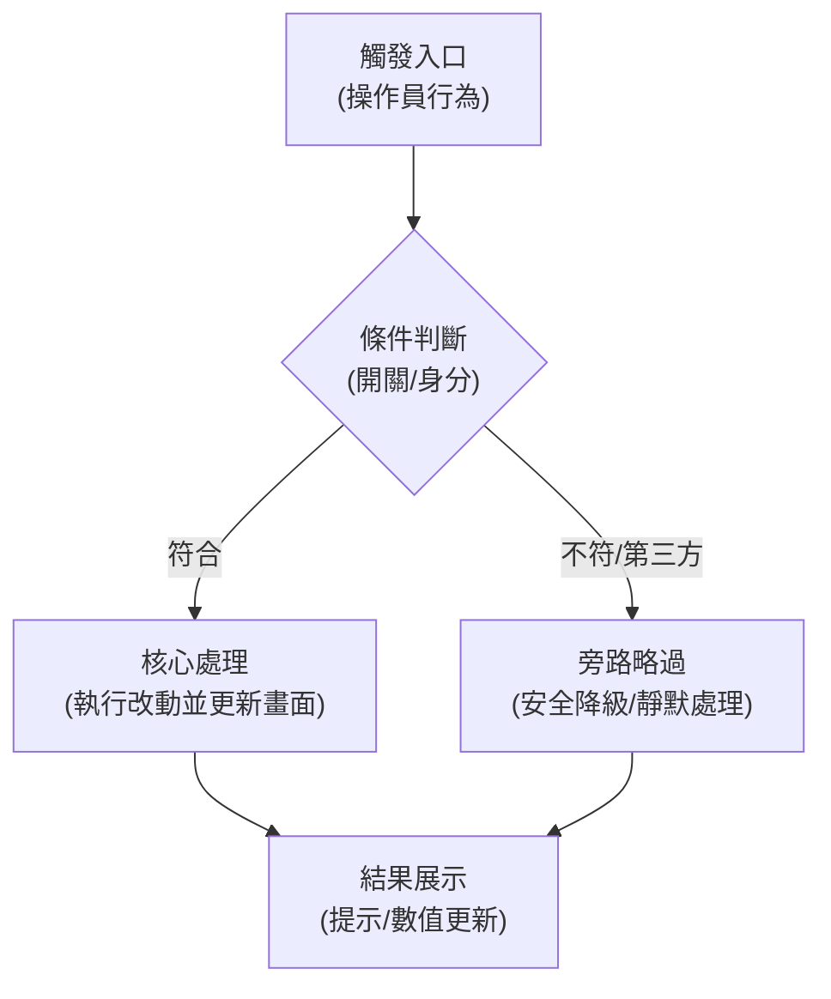

# QA 手動測試手冊 Markdown 標準樣板 (QA Doc Template)

在撰寫 `docs/qa/<module>/QA-<slug>-manual.md` 時，嚴格依循以下章節結構與格式規範：

```markdown
# QA 手動功能測試 SOP — [功能名稱]（[dev / local]）

| 欄位 | 值 |
| --- | --- |
| `owner` | `qa-owner` |
| `status` | `active` |
| `last-verified` | `YYYY-MM-DD` |
| `canonical-source` | 本文件 |
| `sensitivity` | `git-safe` |
| `retention` | `current-until-superseded` |

> 對象：QA 測試人員或驗收代理（Agent）。所有操作都在 POS 畫面上完成。不用改設定檔，不用下 SQL。
> 站台：`https://www.zdpos.tw/<merchant>/pos/index` 或本地容器 `https://www.posdev.test/<env>/pos/index`
> 歷史背景：[一句話說明為何有此需求或修正，歷史痛點是什麼，解決了什麼爭議或安全漏洞]。

---

## 怎麼讀這份文件

每個測試案例（TC）都分成四段：

- **在確認什麼**：一句話。說明使用者看得到的改動。
- **操作**：一步只做一個動作。每一步後面寫「應該看到」什麼。
- **Pass**：看到這個結果就打勾 Pass。
- **Fail**：看到這個結果就開單。

只照「操作」做，只用「Pass／Fail」判斷。遇到文件沒寫的情況，就記在「實際結果」，不要自己猜。

### 先確認「走對地方」，再判斷 Pass／Fail

功能與商戶設定緊密相關（如模組開關、按鈕配置）。在未配置的環境或機號測，會得到錯誤結論：

- 每個 TC 開頭都有「**適用條件**」表：門市／機號、測試對象、前置狀態、按鈕在哪裡、會看到什麼。
- 表裡的「**怎麼確認開對了**」是畫面上看得到的特徵。
- **對不上就停下來**：這項勾 **Blocked** 或 **N/A**，在「實際結果」寫下你用的條件和看到的畫面，**不要隨意勾 Fail**。

---

## 本文不測的項目（由開發／維運驗證）

下列項目 QA 在一般手動操作介面上做不出來，或屬底層防護。開發已經用自動測試驗證過：

| 項目 | 為什麼 QA 做不出來 | 開發／維運驗證依據 |
|---|---|---|
| [底層資料庫交易 ACID / CAS 精度比對] | 畫面看不出資料庫 row 與交易鎖狀態 | `protected/tests/integration/...Test.php` |
| [微秒級並行併發防護] | 人工操作無法做到毫秒級微秒並行發送請求 | `protected/tests/unit/...Test.php` 或 Playwright 腳本 |
| [第三方外部 API 模擬/中斷] | 需專屬模擬器或偽造外部主機通訊協定 | `protected/tests/unit/...Test.php` |
| [資料庫 Schema 遷移與按鈕配置] | 屬於系統管理員與維運權限 | 部署手冊或 Migration 檔案 |

---

## 0. 先弄懂「[核心機制/業務流程名稱]」

後面測試都跟核心運作邏輯有關，必須先弄懂新舊流程差異與防護原則：

```
傳統流程：[過去舊有行為流程] ──► [產生問題或抱怨]
本次改動：[本次新機制流程] ──► [保障安全與體驗]
```


> 💡 **Mermaid 語法鐵律**：在流程圖節點中，若文字包含小括號 `()`、花括號 `{}`、方括號 `[]` 或換行 `<br/>`，一律使用雙引號包裹（如 `Node["執行 action(param)"]`），防止 Mermaid 10.9.8 報錯 `Syntax error in text`。

- **核心原則 1（冪等性）**：重複操作時不應重複扣減或引發二次副作用。
- **核心原則 2（安全降級）**：異常中斷時維持交易安全，不應造成畫面白屏卡死。
- **核心原則 3（邊界豁免）**：特殊類型或第三方資料依規範豁免或轉由專屬模組處理。

---

## 1. 這次要測什麼

| # | 使用者看得到的改動 | 對應 TC |
|---|---|---|
| 1 | [改動項目 1 描述] | TC-01 |
| 2 | [改動項目 2 核心路徑描述] | TC-02 ★ |
| 3 | [改動項目 3 冪等性防重複描述] | TC-03 ★ |
| 4 | [改動項目 4 邊界/極限值描述] | TC-04 |
| 5 | 整輪測試結束後確認 DevTools Console 無非預期之紅色例外錯誤 | TC-05 |

---

## 2. 開始前準備與資料前置

| 項目 | 說明 |
|---|---|
| 站台確認 | 開啟 `https://www.zdpos.tw/<merchant>/pos/index`，登入頁確認資料庫 |
| 門市／機號 | **門市 114、機號 15**（零售模式，不用開桌）或專用機號 |
| 測試角色 A（目標情境） | [具備特徵 A 之測試資料，如含有特定待處理批次] |
| 測試角色 B（邊界情境） | [具備特徵 B 之測試資料，如極限歸零或第三方] |
| 瀏覽器 | Chrome。按 **F12** 打開 DevTools，切到 **Console** 分頁。整輪都不要關 |
| 第一件事 | 進 `pos/index` 後，按一次 **Ctrl+Shift+R**（強制重新整理） |
| 實際使用的門市／機號 | __________________ / __________________ |
| 測試人員／日期 | __________________ / __________________ |

### 每個 TC 用哪一個顧客／機號（總表）

| TC | 門市／機號 | 測試對象 | 操作重點 | 備註 |
|---|---|---|---|---|
| TC-01 | 114／15 | 任意對象 | 常規操作驗證 | 驗證純讀取/基礎入口 |
| TC-02 | 114／15 | 測試角色 A | 核心觸發流程 | ★核心，驗證主線功能 |
| TC-03 | 114／15 | 測試角色 A | 重複操作驗證 | ★核心，驗證冪等無二次副作用 |
| TC-04 | 114／15 | 測試角色 B | 邊界極限驗證 | 驗證異常降級與邊界保護 |
| TC-05 | 不限 | — | 全程 Console 總檢查 | 全部做完最後做 |

### 會讓你測錯的地方 (Gotchas)

| 情境 | 為什麼會測錯 | 正確做法 |
|---|---|---|
| 拿已測過變更的資料重跑 | 資料狀態已在前次測試中被消耗或改動 | 必須使用「尚未被操作過」的新測試資料 |
| 純文字查詢以為已觸發寫入 | 搜尋是純唯讀的，不會觸發變更寫入 | 必須點選帶入或執行確認才會觸發動作 |
| 特殊外接系統期待本地反饋 | 外部系統由外部主機管轄，本地系統故意豁免 | 靜默不觸發為正確行為，不要隨意勾 Fail |

---

## 3. 測試案例

> 每做完一項，就填「實際結果」並勾選。Fail 也不要跳過：依 §5 開單，並寫明有沒有擋住後面的項目。

---

### TC-01 — [測試案例 1 簡稱]

**適用條件**

| 項目 | 內容 |
|---|---|
| 門市／機號 | 114／15（零售，不用開桌） |
| 功能按鈕 | [按鈕位置路徑] |
| 怎麼確認開對了 | [畫面可見特徵] |

**在確認什麼**：[一句話，說明使用者看得到的行為改動或預防的異常]。

**操作**

1. [操作步驟 1，寫明預期反應]。
2. [操作步驟 2，寫明預期反應]。
3. [操作步驟 3，寫明預期反應]。

**Pass**：[具體可見的成功判定標準]。
**Fail**：[明確的失敗現象描述]。

| 實際結果 | | Pass/Fail | ☐ Pass  ☐ Fail  ☐ Blocked  ☐ N/A |
|---|---|---|---|

---

### TC-02 — [測試案例 2 簡稱] ★核心

**適用條件**

| 項目 | 內容 |
|---|---|
| 門市／機號 | 114／15 |
| 測試對象 | **測試角色 A** |
| 前置狀態 | [初始資料狀態] |

**在確認什麼**：[一句話核心改動]。

**操作**

1. [步驟 1]。
2. [步驟 2]。
3. [步驟 3]。

**Pass**：
- [Pass 條件 1]
- [Pass 條件 2]
**Fail**：[Fail 條件]。

| 實際結果 | | Pass/Fail | ☐ Pass  ☐ Fail  ☐ Blocked  ☐ N/A |
|---|---|---|---|

---

## 4. 簽核與判定標準

- **通過門檻**：
  1. 所有標註 **★核心** 之案例必須 100% 為 **Pass**。
  2. 非核心案例若有 **Blocked** 或 **N/A**，必須附帶明確環境限制原因。
  3. 整輪測試無任何阻斷性重大缺陷，Console 無未捕獲之紅色例外錯誤。
- **簽核記錄**：
  - 測試人員：__________________
  - 驗收判定：☐ PASS  ☐ CONDITIONAL_PASS  ☐ REJECT
  - 簽核日期：YYYY-MM-DD

---

## 5. 缺陷回報開單 SOP

若測試判定為 **Fail**，請依以下格式提交缺陷單：

```markdown
### [Bug 標題] [模組] [簡短描述錯誤現象]
- **觸發 TC**：TC-XX
- **測試環境**：門市 ____、機號 ____、站台 ____
- **重現步驟**：
  1. ...
  2. ...
- **預期結果 (Expected)**：...
- **實際結果 (Actual)**：...
- **Console 錯誤截圖 / 日誌**：...
- **阻斷性評估**：☐ 阻礙後續測試 (Blocker)  ☐ 獨立缺陷 (Non-blocker)
```

---

## 6. 已知狀況（看到不用開單）

| 現象 | 說明 |
|---|---|
| [既有歷史小問題/靜態檔 404] | 舊架構既存問題，非本次改動引入，已另案排程，不用開單 |
| [特殊類型無跳出提示] | 正常規格設計，刻意豁免處理 |

---

## 7. 業務規則與技術判定依據（開發參考）

| 機制項目 | 關鍵判定依據 | 實作位置與技術細節 |
|---|---|---|
| [核心演算法/CAS 防護] | [判定依據] | `[Class::method]` |
| [前端防競態] | [前端 Token / 閘門] | `[js/...js]` |

---

## 8. 附錄：自動化/E2E 基準代跑紀錄 (歷史參考)

| 欄位 | 值 |
| --- | --- |
| `recorded-at` | YYYY-MM-DD |
| 執行方式 | Playwright / PHPUnit |
| 驗收成果 | [測試通過狀態與覆蓋案例] |
```
